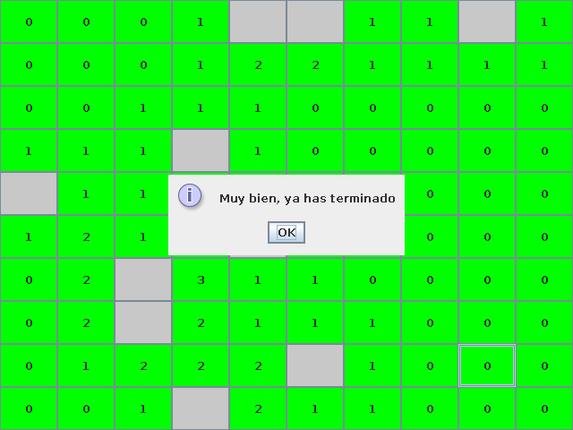
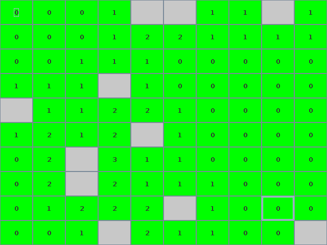

# Java minesweeper exercises · Ejercicios de buscaminas en Java
[English](#english) · [Español](#español)

## English


Legacy Java minesweeper exercises for revealing tiles and counting nearby mines

> [!WARNING]
> **Status: Legacy.** Tested with Java 8. The final 2026 commit fixes mine placement in May and victory in June.

### Overview

These Java exercises use a grid with hidden mines. To play, reveal a square and use its number to work out which nearby squares can contain mines.

### Features

- Open a tile on the 30 × 50 AWT board to see its hint or reveal a mine.
- Set the board size and enter a move with Swing dialogs in the May edition.
- Open the 10 × 10 Swing board as a Java desktop window or an applet.

### Requirements

OpenJDK 8 with a graphical environment and the standard AWT and Swing packages. The build reads the archived files as Windows-1252. For the applet variant use the `appletviewer` shipped with JDK 8.

### Getting started

In PowerShell at the root, compile the available variants into separate output folders.

```powershell
New-Item -ItemType Directory -Force out/original | Out-Null
javac -encoding windows-1252 -d out/original Buscaminas.java

New-Item -ItemType Directory -Force out/may | Out-Null
javac -encoding windows-1252 -d out/may Buscaminas3.java

New-Item -ItemType Directory -Force out/june | Out-Null
javac -encoding windows-1252 -d out/june netbeans/buscaminas/src/buscaminas/Buscaminas.java netbeans/buscaminas/src/buscaminas/BuscaminasA.java

```

### Usage

- Start the 2003 board with `java -cp out/original Buscaminas`. Click a tile to reveal the number of nearby mines. Close the window to exit.
- Run `java -cp out/may Buscaminas3`. In the dialogs, enter the board dimensions (for example, 10 and 10) and a zero-based row and column. A mine displays the loss dialog. The board now places 20 mines in distinct squares.
- Run `java -cp out/june Buscaminas` to open the 10 × 10 Swing board. Run `appletviewer examples/applet.html` with JDK 8 to load the applet wrapper. Reveal all 90 safe squares without hitting a mine to finish. The desktop window title counts the safe squares left. The applet displays the victory dialog inside its host.

### Project structure

`Buscaminas.java` is the 2003 desktop entry point. `Buscaminas3.java` contains the May 2007 dialog variant. `netbeans/buscaminas/src/buscaminas/` holds the June desktop and applet classes.

### Contributing

This archive is kept for reference and does not accept contributions.

### Support

Use this repository’s Issues for questions about the archive.

### History

The archived commits preserve the original files and the documented failures in May and June. A separate 2026 commit fixes both. Snapshot dates use 12:00 UTC because the archive has no time zone.

### Verification

On November 18, 2026, the three variants built with Eclipse Temurin 8u512-b09 on Ubuntu 22.04, with Xvfb `2:21.1.4-2ubuntu1.7~22.04.16` in a container without networking. The build commands above were used. The separate `NocheMines.java` verifier is kept with the test records. It called the actual entry points, set repeatable seeds through Java reflection and hosted the applet lifecycle in an AWT window. The test tried 100 seeds at each of three board sizes. All 300 May boards contained 20 distinct mines. The June desktop triggered victory after opening 90 safe squares and never after a loss. The AWT board and applet opened a numbered square, and confirming applet victory left the host running. The four previous commits retain their own recorded build and execution results.





```text
java -cp out/original NocheMines original
java -cp out/may NocheMines fixed-placement
java -cp out/may NocheMines may
java -cp out/june NocheMines june-fixed
java -cp out/june NocheMines june-loss-fixed
java -cp out/june NocheMines applet
java -cp out/june NocheMines applet-victory
timeout 4s appletviewer examples/applet.html
```

### License

[MIT License](LICENSE) applies to the project’s own contributions. The applet retains its original author credit.

---

## Español


Legado de ejercicios de buscaminas en Java para destapar casillas y contar minas cercanas

> [!WARNING]
> **Estado: legado.** Probado con Java 8. El commit final de 2026 corrige la colocación de mayo y la victoria de junio.

### Descripción general

Estos ejercicios de Java usan una cuadrícula con minas ocultas. Destapa una casilla y usa su número para deducir cuáles de las casillas cercanas pueden contener minas.

### Funciones

- Abre una casilla del tablero AWT de 30 × 50 para ver su pista o descubrir una mina.
- Ajusta el tamaño del tablero e introduce la jugada con los cuadros de Swing de la edición de mayo.
- Abre el tablero Swing de 10 × 10 en una ventana de escritorio Java o en un applet.

### Requisitos

OpenJDK 8 con entorno gráfico y los paquetes AWT y Swing de la biblioteca estándar. La compilación lee los archivos archivados como Windows-1252. Para el applet usa `appletviewer`, incluido en JDK 8.

### Cómo empezar

Desde PowerShell en la raíz, compila las variantes disponibles en carpetas de salida separadas.

```powershell
New-Item -ItemType Directory -Force out/original | Out-Null
javac -encoding windows-1252 -d out/original Buscaminas.java

New-Item -ItemType Directory -Force out/may | Out-Null
javac -encoding windows-1252 -d out/may Buscaminas3.java

New-Item -ItemType Directory -Force out/june | Out-Null
javac -encoding windows-1252 -d out/june netbeans/buscaminas/src/buscaminas/Buscaminas.java netbeans/buscaminas/src/buscaminas/BuscaminasA.java

```

### Uso

- Inicia el tablero de 2003 con `java -cp out/original Buscaminas`. Haz clic en una casilla para ver cuántas minas hay cerca. Cierra la ventana para salir.
- Ejecuta `java -cp out/may Buscaminas3`. En los cuadros, introduce las dimensiones (por ejemplo, 10 y 10) y una fila y columna empezando por cero. Una mina abre el aviso de derrota. El tablero coloca 20 minas en casillas distintas.
- Ejecuta `java -cp out/june Buscaminas` para abrir el tablero Swing de 10 × 10. Ejecuta `appletviewer examples/applet.html` con JDK 8 para cargar el envoltorio applet. Destapa las 90 casillas seguras sin tocar una mina para ganar. El título de la ventana de escritorio indica cuántas quedan y el applet muestra el aviso de victoria dentro de su visor.

### Estructura del proyecto

`Buscaminas.java` es la entrada de escritorio de 2003. `Buscaminas3.java` contiene la variante con cuadros de mayo de 2007. `netbeans/buscaminas/src/buscaminas/` reúne las clases de escritorio y applet de junio.

### Contribuir

Este archivo se conserva como referencia y no acepta contribuciones.

### Soporte

Usa la sección Issues del repositorio para preguntas sobre el archivo.

### Historia

Los commits históricos conservan los archivos y documentan los fallos de mayo y junio. Un commit nuevo de 2026 corrige ambos. Las fechas de las copias usan las 12:00 UTC porque el archivo carece de zona horaria.

### Verificación

El 18 de noviembre de 2026 se compilaron las tres variantes con Eclipse Temurin 8u512-b09 en Ubuntu 22.04, con Xvfb `2:21.1.4-2ubuntu1.7~22.04.16` en un contenedor sin red. Se usaron los comandos de compilación anteriores. El verificador `NocheMines.java` se conserva con los registros de ensayo. Llamó los puntos de entrada reales, fijó semillas con reflexión de Java y probó el ciclo de vida del applet en una ventana AWT. Se probaron 100 semillas en cada uno de tres tamaños. Los 300 tableros de mayo tuvieron 20 minas distintas. La ventana de junio mostró la victoria tras abrir 90 casillas seguras e impidió ganar después de una derrota. El tablero AWT y el applet destaparon una casilla numerada. Al confirmar la victoria del applet, el visor siguió abierto. Los cuatro commits anteriores conservan sus registros de compilación y ejecución.


```text
java -cp out/original NocheMines original
java -cp out/may NocheMines fixed-placement
java -cp out/may NocheMines may
java -cp out/june NocheMines june-fixed
java -cp out/june NocheMines june-loss-fixed
java -cp out/june NocheMines applet
java -cp out/june NocheMines applet-victory
timeout 4s appletviewer examples/applet.html
```

### Licencia

La [licencia MIT](LICENSE) se aplica a los aportes propios. El applet conserva su crédito de autor original.
